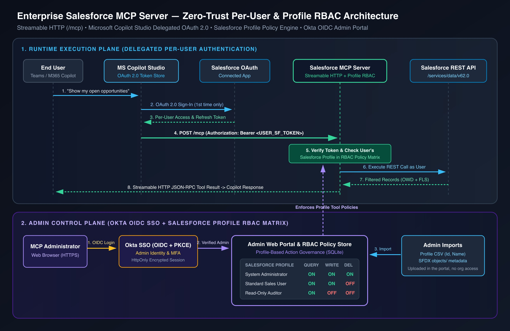

# 🏗️ Architecture & Sequence Flows



## 1. Key Architectural Insight: How Per-User OAuth Works in MCP

A common misconception when building an authenticated MCP server for Microsoft Copilot Studio is assuming the MCP server itself acts like a traditional web website that responds with an `HTTP 302 Redirect` to `login.salesforce.com` when a user isn't signed in.

### Why `HTTP 302 Redirect` Does Not Work on `/mcp`
1. **End users never browse to `/mcp` directly.** Microsoft Copilot Studio's cloud orchestrator sends background `POST /mcp` JSON-RPC 2.0 requests.
2. If your `/mcp` endpoint returns an HTML login screen or a `302 Found` redirect, Copilot Studio's JSON-RPC parser fails the tool invocation.

### How Delegated Per-User OAuth 2.0 Actually Works
1. **Unauthenticated Challenge (`401 Unauthorized`):** If a request arrives at `POST /mcp` without a valid `Authorization: Bearer <token>`, the MCP server responds with `HTTP 401 Unauthorized` and a `WWW-Authenticate` header pointing to `/.well-known/oauth-protected-resource` (RFC 9728).
2. **Copilot Studio OAuth Sign-In Card:** Microsoft Copilot Studio manages the OAuth 2.0 Authorization Code flow with Salesforce. When a user invokes a Salesforce action in Teams or M365 Copilot for the first time, Copilot renders a native **"Sign in to Salesforce"** card.
3. **Token Lifecycle Management:** Once the user authenticates in Salesforce, Copilot Studio securely stores that specific user's `access_token` and `refresh_token` in the Power Platform Token Store and automatically refreshes expired tokens.
4. **Stateless Token Passthrough:** On every MCP request (`tools/list` and `tools/call`), Copilot Studio sends:
   ```http
   POST /mcp HTTP/1.1
   Authorization: Bearer <USER_SALESFORCE_ACCESS_TOKEN>
   Content-Type: application/json
   Accept: application/json, text/event-stream
   ```
5. **Dual-Layer Enforcement (MCP Profile RBAC + Salesforce Native Security):**
   * **Layer 1 (MCP Server Policy Engine):** The MCP server verifies the token against Salesforce, resolves the user's `ProfileId` and `Profile.Name`, and evaluates the **Profile → Access Group** matrix configured in the Admin Portal:
     * When Copilot calls `tools/list`, the MCP server filters the returned tool list so the user's Copilot session only sees the tools granted by the groups mapped to their Salesforce Profile.
     * When Copilot calls `tools/call`, the MCP server verifies the **Tool** (e.g., `update_record`), the **Target sObject** and its CRUD permission (e.g., `canUpdate` on `Opportunity`), and every **Field** requested, written or used in a filter, before anything is sent to Salesforce. Every call is written to the PII-stripped Copilot MCP log.
   * **Layer 2 (Salesforce REST API):** The MCP server executes the REST API call (`/services/data/v62.0/...`) using the user's own Bearer token. Salesforce natively enforces Org-Wide Defaults (OWD), Role Hierarchy, Sharing Rules, Object CRUD, and Field-Level Security (FLS).

---

## 2. End-to-End Sequence Diagram

```mermaid
sequenceDiagram
    autonumber
    actor User as End User (Teams / M365)
    participant Copilot as Microsoft Copilot Studio
    participant SFAuth as Salesforce OAuth 2.0
    participant MCP as Salesforce MCP Server (/mcp)
    participant RBAC as Profile RBAC Policy Engine (SQLite)
    participant SFAPI as Salesforce REST API
    actor Admin as MCP Administrator
    participant Portal as Next.js Admin Portal (:3000)
    participant Okta as Okta SSO (OIDC + PKCE)

    rect rgb(30, 41, 59)
    Note over Admin,SFAPI: Plane 1: Admin Control Plane (Okta SSO + Profile RBAC Configuration)
    Admin->>Portal: Open Admin Portal (/)
    Portal->>MCP: /auth/okta/login (proxied to the backend on :3001)
    MCP->>Okta: Redirect to Okta OIDC (/authorize + PKCE S256)
    Okta-->>Admin: Authenticate Admin & MFA
    Okta-->>MCP: Authorization Code -> Verify ID Token via Okta JWKS
    Admin->>Portal: Import Profiles (CSV) and Objects & Fields (SFDX folder)
    Portal->>MCP: /api/admin/* (session cookie + X-CSRF-Token)
    MCP->>RBAC: Upsert Profiles, Objects and Fields
    Admin->>Portal: Build Access Groups (tools, object CRUD, allowed fields) and map Profiles to Groups
    Portal->>MCP: /api/admin/groups, /api/admin/profile-groups/:profileId
    MCP->>RBAC: Store Profile -> Group matrix
    end

    rect rgb(15, 23, 42)
    Note over User,SFAPI: Plane 2: Runtime MCP Execution Plane (Per-User Delegated Auth)
    User->>Copilot: "Update Opportunity Stage to Closed Won"
    alt User not authenticated in Copilot Studio
        Copilot->>User: Display Salesforce Sign-In Card
        User->>SFAuth: Login & Consent (Per-User OAuth 2.0)
        SFAuth-->>Copilot: Per-User Access Token & Refresh Token
    end
    Copilot->>MCP: POST /mcp (tools/call: update_record)<br/>Header: Authorization: Bearer <USER_SF_TOKEN>
    MCP->>SFAPI: Verify Token & Resolve User Identity + ProfileId<br/>(/services/oauth2/userinfo + User.Profile.Name)
    SFAPI-->>MCP: User Verified (Profile: "Custom: Sales Representative")
    MCP->>RBAC: Evaluate if "Custom: Sales Representative" can run "update_record" on "Opportunity"
    alt Tool & Object Allowed for Profile
        RBAC-->>MCP: PERMIT (tool + canUpdate on Opportunity + allowed fields)
        MCP->>SFAPI: PATCH /services/data/v62.0/sobjects/Opportunity/{id}<br/>Header: Authorization: Bearer <USER_SF_TOKEN>
        SFAPI-->>MCP: 204 No Content (Updated as User)
        MCP-->>Copilot: MCP Tool Result (Success)
        Copilot-->>User: "Opportunity updated to Closed Won!"
    else Tool or Object Denied for Profile
        RBAC-->>MCP: DENY (Action blocked for Profile)
        MCP-->>Copilot: MCP Tool Error (ACCESS_DENIED), logged as DENIED
        Copilot-->>User: "Your Salesforce profile does not permit this action via Copilot."
    end
    end
```



---

## 3. Two-Plane System Architecture

| Plane | Purpose | Authentication Mechanism | Key Endpoints |
| :--- | :--- | :--- | :--- |
| **Runtime MCP Plane** | Handles JSON-RPC 2.0 tool discovery and execution from Microsoft Copilot Studio | Per-User Salesforce OAuth 2.0 Bearer Token (`Authorization: Bearer <token>`) | `POST /mcp`<br/>`GET /.well-known/oauth-protected-resource` |
| **Admin Control Plane** | Next.js portal for importing Salesforce Profiles and Objects, building Access Groups and the Profile → Group matrix, configuring Okta SSO, testing policies in the simulator, and viewing audit logs | Okta OIDC Authorization Code Flow with PKCE (`S256`) + Remote JWKS Verification, plus a break-glass username/password login | `GET /` (portal)<br/>`GET /auth/okta/login`<br/>`GET /auth/okta/callback`<br/>`/api/admin/*` |

---

## 4. Process Layout

| Process | Port | Responsibility |
| :--- | :--- | :--- |
| **Next.js Admin Portal** (`src/app/`, `src/components/`) | `3000` | Serves the admin UI and is the single public origin (`BASE_URL`). `next.config.ts` rewrites `/mcp`, `/api/admin/*`, `/auth/okta/*`, `/.well-known/*`, `/healthz` and `/docs/*` to the backend at `MCP_BACKEND_URL`. |
| **Express MCP backend** (`src/index.ts`) | `3001` | Implements every endpoint above against the SQLite store (`node:sqlite`, WAL). It serves no HTML; `GET /` redirects browsers to the portal. |

`npm run dev` starts both (`scripts/run-stack.mjs`); `npm run build` compiles the backend to `dist/` and builds the portal; `npm start` runs both production builds.
